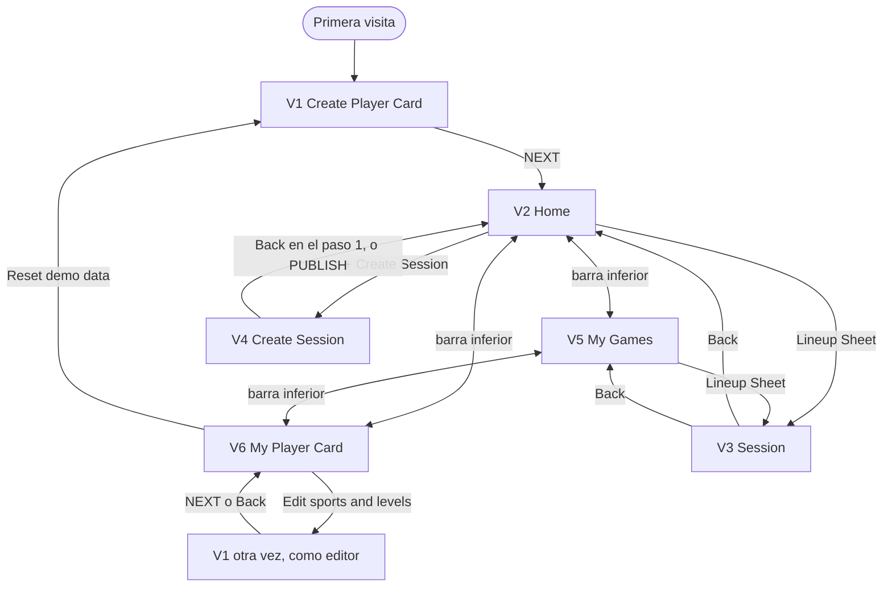
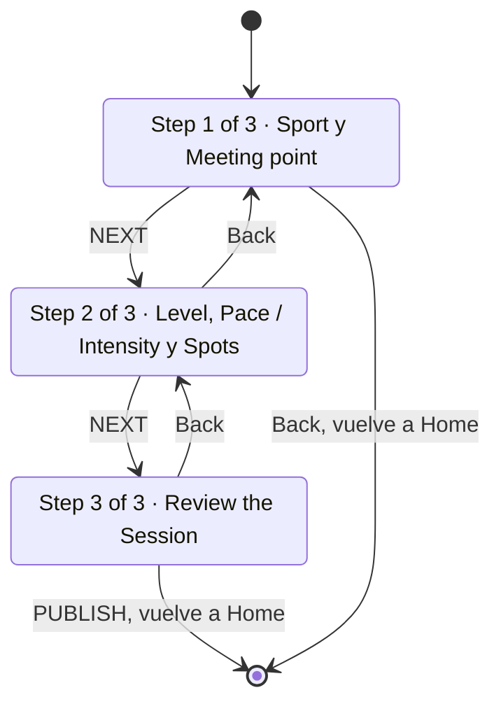
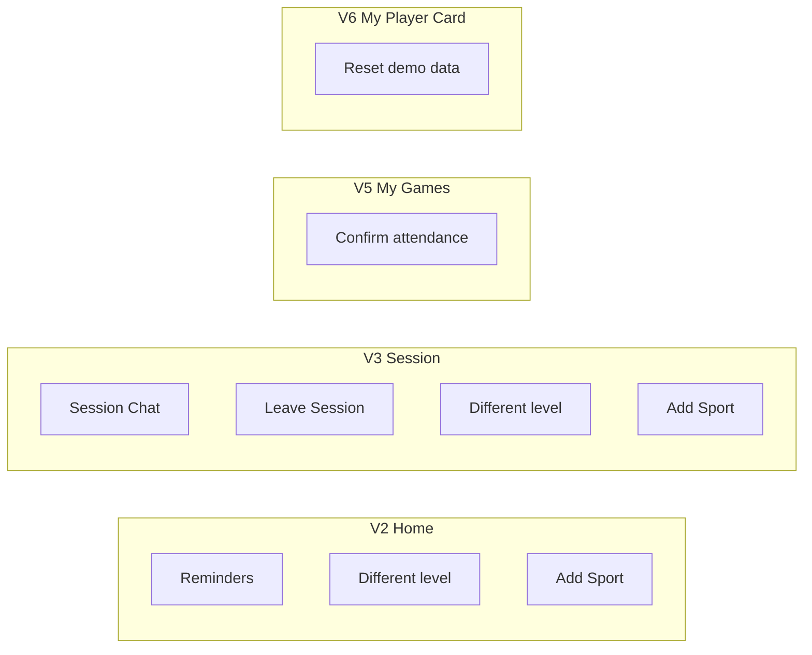

# SportMatch — pantallas y subpantallas

Las seis vistas del prototipo. Las cajas grandes son pantallas. Las cajas de dentro son subpantallas: se abren encima, sin cambiar de ruta.

## Jerarquía

```mermaid
flowchart TB
  APP["SportMatch"]

  APP --> V1
  APP --> TABS
  APP --> V3
  APP --> V4

  V1["V1 · Create Player Card<br/>primera vez y al editar"]
  V1 --> V1A["Name y Age"]
  V1 --> V1B["Sports you play<br/>Beg. / Int. / Adv."]
  V1 --> V1C["NEXT"]

  TABS["Barra inferior"]
  TABS --> V2
  TABS --> V5
  TABS --> V6

  V2["V2 · Home<br/>Noticeboard feed"]
  V2 --> V2A["Filtros<br/>All · Basketball · Football · Near Me"]
  V2 --> V2B["Tarjetas de Session"]
  V2 --> V2C["Reminders"]
  V2 --> V2D["Different level<br/>Join anyway?"]
  V2 --> V2E["Add Sport"]

  V3["V3 · Session<br/>Lineup Sheet"]
  V3 --> V3A["Meeting point<br/>pin y Open in Maps"]
  V3 --> V3B["Lineup Sheet<br/>huecos numerados"]
  V3 --> V3C["Session Chat"]
  V3 --> V3D["Leave Session"]
  V3 --> V3E["JOIN GAME<br/>o SESSION FULL"]

  V4["V4 · Create Session"]
  V4 --> V4A["Step 1 of 3<br/>Sport y Meeting point"]
  V4 --> V4B["Step 2 of 3<br/>Level, Pace / Intensity, Spots"]
  V4 --> V4C["Step 3 of 3<br/>Review the Session"]

  V5["V5 · My Games"]
  V5 --> V5A["Upcoming<br/>Are you going? Yes / No"]
  V5 --> V5B["1h reminder!"]
  V5 --> V5C["Past<br/>Attended / No-show"]
  V5 --> V5D["Confirm attendance"]

  V6["V6 · My Player Card"]
  V6 --> V6A["Attendance y deportes"]
  V6 --> V6B["Edit sports and levels"]
  V6 --> V6C["Reset demo data"]
```

## Cómo se navega

La primera vez solo existe V1. Después, Home, My Games y My Player Card se cambian con la barra inferior. El detalle y crear una sesión se salen de esa barra y se cierran con Back.

Create Session no cambia de pantalla: Back baja un paso y NEXT sube un paso.

## Qué se abre encima de cada pantalla

Estas piezas no son rutas. Se cierran con Cancel, Close o tocando fuera.

| Pantalla | Subpantalla | Cuándo aparece |
|---|---|---|
| V2 Home y V3 Session | Different level | El Level de la Session no es el de la Player Card |
| V2 Home y V3 Session | Add Sport | Ese Sport no está en la Player Card |
| V2 Home | Reminders | Se pulsa la campana |
| V3 Session | Session Chat | Solo Host y confirmed players |
| V3 Session | Leave Session | Se pulsa LEAVE SESSION |
| V5 My Games | Confirm attendance | El Host revisa quién vino |
| V6 My Player Card | Reset demo data | Se pulsa Reset demo data |
